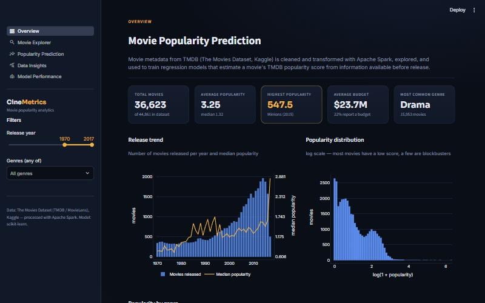

# Movie Popularity Prediction Using Big Data and Machine Learning

A university Big Data project that cleans and transforms ~45,000 movies with **Apache Spark (PySpark)**,
explores what is associated with movie popularity, trains and compares **regression models** that predict a
movie's TMDB popularity score from information available **before release**, and presents everything in an
interactive **Streamlit** dashboard.



## Objectives
1. Collect a real-world movie dataset and document its source.
2. Clean and prepare it with PySpark (DataFrames, filtering, aggregation, joins, Spark SQL, window functions).
3. Perform EDA and identify meaningful patterns.
4. Train, tune and evaluate regression models (MAE, RMSE, R²) without data leakage.
5. Deliver a professional interactive dashboard with KPIs, filters, insights, predictions and model results.

## Technologies
| Stage | Tools |
|-------|-------|
| Data processing & cleaning | Apache Spark 4 / PySpark (Java 17) |
| EDA | pandas, NumPy, Matplotlib, Seaborn |
| Machine learning | scikit-learn (Pipeline, ColumnTransformer, GridSearch/RandomizedSearch CV) |
| Dashboard | Streamlit + Plotly |
| Notebooks / versioning | Jupyter, Git & GitHub |

## Dataset
**The Movies Dataset** — Rounak Banik, Kaggle (CC0: Public Domain):
<https://www.kaggle.com/datasets/rounakbanik/the-movies-dataset>.
Metadata comes from the TMDB API and ratings from GroupLens MovieLens. Notebook 01 downloads the files
automatically from a public byte-identical mirror (<https://huggingface.co/datasets/gaygaaa/TheMoviesDataset>)
if they are not already in `data/raw/`.

| File | Rows | Use |
|------|------|-----|
| `movies_metadata.csv` (34 MB) | 45,466 | main dataset — features and target |
| `links.csv` | 45,843 | join key MovieLens `movieId` → TMDB `id` |
| `ratings_small.csv` | 100,004 | post-release engagement analysis only (never a model input) |

**Target:** `popularity` — a TMDB activity score (page views, votes, watch-lists…) captured when the dataset was
collected (2017). The model predicts `log(1 + popularity)` because the raw score is extremely skewed.

## Folder structure
```
Movie-Popularity-Prediction/
├── data/
│   ├── raw/                     # original CSV files (downloaded by notebook 01, git-ignored)
│   └── processed/               # Parquet outputs of notebook 01 (committed, used by the dashboard)
├── notebooks/
│   ├── 01_data_processing_and_cleaning.ipynb   # ALL PySpark loading, inspection, cleaning,
│   │                                           # feature engineering, Spark SQL, joins, validation, saving
│   ├── 02_eda.ipynb                            # exploratory data analysis + figures
│   └── 03_model_training.ipynb                 # model training, tuning, evaluation, export
├── models/                      # best_model.pkl + metadata, comparison, test predictions, importances
├── dashboard/
│   ├── app.py                   # Streamlit dashboard (5 pages)
│   └── requirements.txt         # light dependencies for Streamlit Community Cloud
├── reports/
│   ├── Project_Report.md        # final report
│   ├── Movie_Popularity_Presentation.pptx
│   ├── eda_findings.json        # findings computed by notebook 02
│   ├── figures/                 # charts exported by notebooks 02 and 03
│   └── screenshots/             # dashboard screenshots
├── .streamlit/config.toml       # dark theme
├── requirements.txt             # full project dependencies
└── README.md
```

## Installation (local)
Requirements: **Python 3.12+** and **Java 17 or 21** (Spark runs on the JVM).

```bash
python -m venv .venv
```
Windows: `.venv\Scripts\activate` · macOS/Linux: `source .venv/bin/activate`
```bash
pip install -r requirements.txt
```

**Java.** Install a JDK (e.g. Eclipse Temurin 17 from <https://adoptium.net>) and set `JAVA_HOME`. Alternatively,
unzip a portable JDK into a `.tools/` folder at the project root — notebook 01 detects `.tools/jdk*`
automatically. On Windows, Spark prints a harmless `winutils.exe` warning; the project does not need Hadoop
binaries because outputs are written with pyarrow.

## Execution order
```bash
jupyter notebook
```
Run, in order:
1. `notebooks/01_data_processing_and_cleaning.ipynb` → `data/processed/*.parquet` (≈1 min)
2. `notebooks/02_eda.ipynb` → `reports/figures/*.png`, `reports/eda_findings.json`
3. `notebooks/03_model_training.ipynb` → `models/*` (≈1 min)

Or headless:
```bash
cd notebooks && jupyter nbconvert --to notebook --execute --inplace 01_data_processing_and_cleaning.ipynb 02_eda.ipynb 03_model_training.ipynb
```

## Launch the dashboard
From the project root:
```bash
streamlit run dashboard/app.py
```
Pages: **Overview** (KPIs, trends) · **Movie Explorer** (search, genre/year/language/budget filters, sorting,
detail card) · **Popularity Prediction** (form → saved model) · **Data Insights** (genre, budget, trends,
runtime, language, correlation) · **Model Performance** (comparison, actual vs predicted, residuals, feature
importance). The dashboard only reads the processed data and the saved model; it never retrains.

## Online deployment (Streamlit Community Cloud)
1. Push the repository to GitHub. `data/processed/` (≈13 MB) and `models/` (≈1 MB) **must be committed**;
   `data/raw/`, `.venv/` and `.tools/` are git-ignored.
2. On <https://share.streamlit.io> → *Create app* → choose the repo, branch `main`, main file `dashboard/app.py`.
3. *Advanced settings* → Python **3.12** (or newer).
4. Deploy. Cloud installs `dashboard/requirements.txt` (the file next to the entrypoint) — no Spark/Java needed.

Common errors: *ModuleNotFoundError* → dependency missing from `dashboard/requirements.txt`;
*model fails to load* → scikit-learn version differs from the one that trained `best_model.pkl` (keep the pins
identical, or retrain); *processed data not found* → `data/processed/` was not committed. No secrets or API keys
are used.

## Model information
Features (pre-release only): log budget, budget-known flag, runtime, release year and month, number of genres,
20 genre flags, original language (one-hot, rare → "infrequent"), franchise/collection membership, number of
production companies and countries, US-production flag.
**Excluded to prevent leakage:** revenue, vote count, vote average, MovieLens ratings.

Test-set results (20% hold-out, 8,973 movies; selection by 3-fold CV RMSE on the training set):

| Model | MAE (log) | RMSE (log) | R² (log) | R² (original scale) |
|-------|-----------|------------|----------|---------------------|
| Baseline (mean) | 0.667 | 0.801 | 0.000 | −0.026 |
| Linear Regression | 0.444 | 0.566 | 0.500 | 0.161 |
| Decision Tree | 0.434 | 0.561 | 0.509 | 0.176 |
| Random Forest | 0.409 | 0.529 | 0.563 | 0.189 |
| **Gradient Boosting (selected)** | **0.403** | **0.523** | **0.573** | **0.200** |

Most important features (permutation importance): log budget, number of production companies, release year,
runtime, US production.

## Limitations
- Popularity is a time-dependent 2017 snapshot, not a fixed pre-release outcome; recent films are favoured.
- Only 19% of movies report a budget; unknown budgets are modelled with a flag.
- Metadata cannot capture marketing, cast, reviews or word of mouth → R² ≈ 0.57 on log scale; on the raw scale
  large blockbusters remain hard to predict exactly (R² ≈ 0.20).
- Data ends in 2017; predictions for later years are extrapolations.

## Team members
| Member | Responsibility |
|--------|----------------|
| Member 1 — _name_ | Data collection & dataset research |
| Member 2 — _name_ | PySpark processing notebook (01) |
| Member 3 — _name_ | EDA & visualisation (02) |
| Member 4 — _name_ | Machine learning & evaluation (03) |
| Member 5 — _name_ | Streamlit dashboard, integration & deployment |

## References
- R. Banik, *The Movies Dataset*, Kaggle, 2017. https://www.kaggle.com/datasets/rounakbanik/the-movies-dataset
- The Movie Database (TMDB) API. https://www.themoviedb.org/documentation/api
- F. M. Harper, J. A. Konstan, *The MovieLens Datasets: History and Context*, ACM TiiS 5(4), 2015.
- Apache Spark documentation. https://spark.apache.org/docs/latest/
- Pedregosa et al., *Scikit-learn: Machine Learning in Python*, JMLR 12, 2011.
- Streamlit documentation. https://docs.streamlit.io
